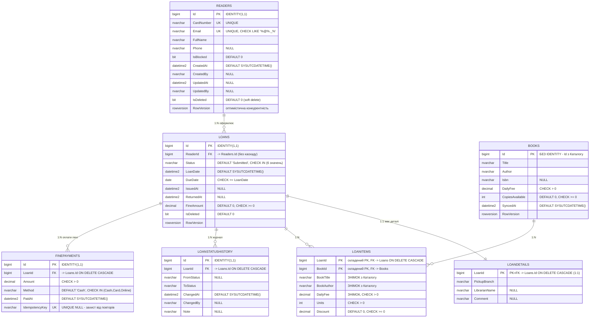
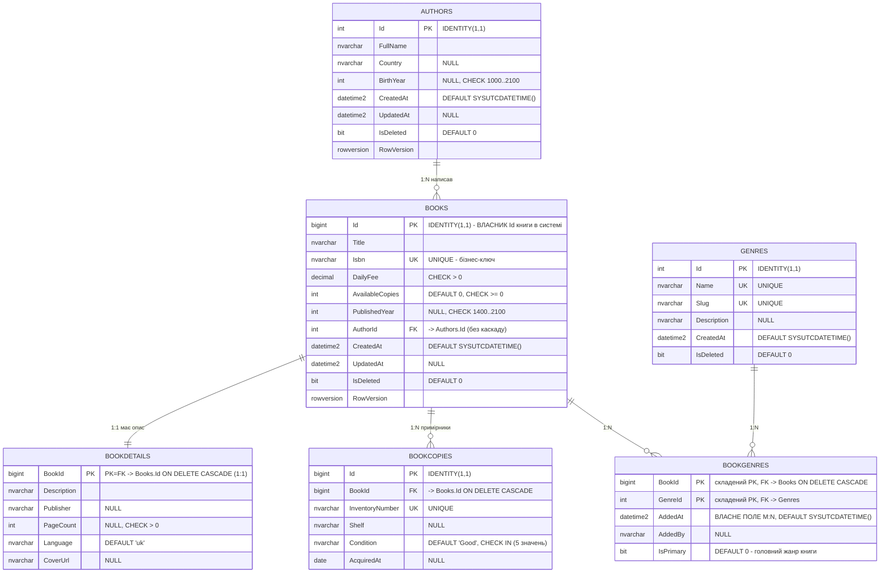
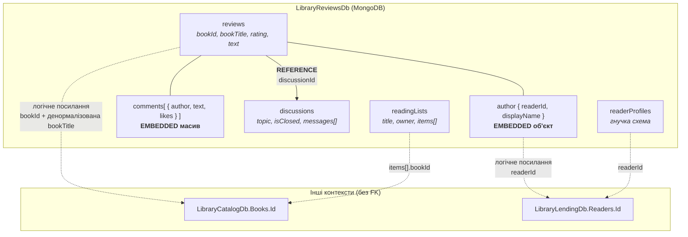

# ERD-діаграми — «Система управління бібліотекою»

> Лабораторна робота № 01. Діаграми для Проєктів №1 і №2 з ключами, типами
> зв'язків, індексами та обмеженнями. Діаграми у форматі Mermaid рендеряться
> безпосередньо на GitHub; нижче наведено також DSL для dbdiagram.io.

---

## 1. Проєкт №1 — `LibraryLendingDb` (SQL Server + ADO.NET & Dapper)

### 1.1. Mermaid ERD



### 1.2. Три типи зв'язків і розміщення зовнішнього ключа

| Тип | Зв'язок | Де стоїть FK | Реалізація |
|---|---|---|---|
| **1:1** | `Loans` ↔ `LoanDetails` | у **залежній** таблиці `LoanDetails` | `LoanId` є **одночасно PK і FK** — фізично неможливо мати два рядки деталей на одну видачу |
| **1:N** | `Readers` → `Loans` | у таблиці на боці **«багатьох»** (`Loans.ReaderId`) | звичайний FK **без каскаду**: читача з історією видач не видаляємо |
| **M:N** | `Loans` ↔ `Books` | у **проміжній** таблиці `LoanItems` | два FK + складений PK `(LoanId, BookId)` + власні поля (`Units`, `Discount`, знімки) |

### 1.3. Індекси та запити, під які вони створені

| Індекс | Під який запит | Особливість |
|---|---|---|
| `IX_Readers_Active_CardNumber` | «знайти читача за номером картки» | **фільтрований** `WHERE IsDeleted = 0`, `INCLUDE (FullName, Email)` — покриваючий |
| `IX_Books_Title` | «пошук книги за назвою у формі видачі» | `INCLUDE (Author, DailyFee, CopiesAvailable)` — покриваючий |
| `IX_Loans_ReaderId_Status` | «видачі читача з певним статусом» (основний список API) | складений, `INCLUDE (DueDate, FineAmount)` |
| `IX_Loans_Overdue` | «прострочені видачі» (звіт) | **фільтрований** `WHERE Status='Issued' AND IsDeleted=0` |
| `IX_LoanItems_BookId` | «у яких видачах фігурує ця книга» | зворотний бік складеного PK |
| `IX_LoanStatusHistory_LoanId_ChangedAt` | «історія однієї видачі в хронологічному порядку» | складений |
| `IX_FinePayments_LoanId` | «усі оплати по видачі» | `INCLUDE (Amount, PaidAt)` |

Свідомо **не** індексуємо: `Loans.LoanDate`, `LoanItems.Units`, `Readers.Phone` —
немає запитів, які б фільтрували за цими стовпцями («сліпе індексування»).

### 1.4. DSL для dbdiagram.io — Проєкт №1

```
// LibraryLendingDb -- вставити на https://dbdiagram.io/d
Table Readers {
  Id bigint [pk, increment]
  CardNumber nvarchar(20) [unique, not null]
  Email nvarchar(256) [unique, not null]
  FullName nvarchar(200) [not null]
  Phone nvarchar(30)
  IsBlocked bit [not null, default: 0]
  CreatedAt datetime2 [not null]
  CreatedBy nvarchar(100)
  UpdatedAt datetime2
  UpdatedBy nvarchar(100)
  IsDeleted bit [not null, default: 0]
  RowVersion rowversion
  Indexes {
    CardNumber [name: 'IX_Readers_Active_CardNumber', note: 'filtered: IsDeleted = 0']
  }
}

Table Books {
  Id bigint [pk, note: 'NO identity -- Id comes from LibraryCatalogDb']
  Title nvarchar(300) [not null]
  Author nvarchar(200) [not null]
  Isbn nvarchar(20)
  DailyFee decimal(18,2) [not null, note: 'CHECK > 0']
  CopiesAvailable int [not null, default: 0, note: 'CHECK >= 0']
  SyncedAt datetime2 [not null]
  RowVersion rowversion
  Indexes {
    Title [name: 'IX_Books_Title']
  }
}

Table Loans {
  Id bigint [pk, increment]
  ReaderId bigint [not null]
  Status nvarchar(30) [not null, default: 'Submitted']
  LoanDate datetime2 [not null]
  DueDate date [not null]
  IssuedAt datetime2
  ReturnedAt datetime2
  FineAmount decimal(18,2) [not null, default: 0]
  CreatedAt datetime2 [not null]
  CreatedBy nvarchar(100)
  UpdatedAt datetime2
  UpdatedBy nvarchar(100)
  IsDeleted bit [not null, default: 0]
  RowVersion rowversion
  Indexes {
    (ReaderId, Status) [name: 'IX_Loans_ReaderId_Status']
    DueDate [name: 'IX_Loans_Overdue', note: "filtered: Status='Issued'"]
  }
}

Table LoanDetails {
  LoanId bigint [pk, note: '1:1 -- PK is also FK']
  PickupBranch nvarchar(100) [not null]
  LibrarianName nvarchar(200)
  Comment nvarchar(1000)
}

Table LoanItems {
  LoanId bigint [pk]
  BookId bigint [pk]
  BookTitle nvarchar(300) [not null, note: 'SNAPSHOT']
  BookAuthor nvarchar(200) [not null, note: 'SNAPSHOT']
  DailyFee decimal(18,2) [not null, note: 'SNAPSHOT']
  Units int [not null, note: 'CHECK > 0']
  Discount decimal(18,2) [not null, default: 0]
  Indexes {
    BookId [name: 'IX_LoanItems_BookId']
  }
}

Table LoanStatusHistory {
  Id bigint [pk, increment]
  LoanId bigint [not null]
  FromStatus nvarchar(30)
  ToStatus nvarchar(30) [not null]
  ChangedAt datetime2 [not null]
  ChangedBy nvarchar(100)
  Note nvarchar(400)
  Indexes {
    (LoanId, ChangedAt) [name: 'IX_LoanStatusHistory_LoanId_ChangedAt']
  }
}

Table FinePayments {
  Id bigint [pk, increment]
  LoanId bigint [not null]
  Amount decimal(18,2) [not null, note: 'CHECK > 0']
  Method nvarchar(30) [not null, default: 'Cash']
  PaidAt datetime2 [not null]
  IdempotencyKey nvarchar(64) [unique]
  Indexes {
    LoanId [name: 'IX_FinePayments_LoanId']
  }
}

// 1:N
Ref: Loans.ReaderId > Readers.Id
// 1:1
Ref: LoanDetails.LoanId - Loans.Id
// M:N through LoanItems
Ref: LoanItems.LoanId > Loans.Id
Ref: LoanItems.BookId > Books.Id
// 1:N
Ref: LoanStatusHistory.LoanId > Loans.Id
Ref: FinePayments.LoanId > Loans.Id
```

---

## 2. Проєкт №2 — `LibraryCatalogDb` (SQL Server + EF Core Code-First)

### 2.1. Mermaid ERD



### 2.2. Три типи зв'язків

| Тип | Зв'язок | Де стоїть FK | Fluent API (Лаб. 03) |
|---|---|---|---|
| **1:1** | `Books` ↔ `BookDetails` | `BookDetails.BookId` (PK=FK) | `HasOne(b => b.Detail).WithOne().HasForeignKey<BookDetail>(d => d.BookId)` |
| **1:N** | `Authors` → `Books` | `Books.AuthorId` | `HasOne(b => b.Author).WithMany(a => a.Books).HasForeignKey(b => b.AuthorId)` |
| **1:N** | `Books` → `BookCopies` | `BookCopies.BookId` | `HasMany(b => b.Copies).WithOne().HasForeignKey(c => c.BookId).OnDelete(Cascade)` |
| **M:N** | `Books` ↔ `Genres` | проміжна `BookGenres` | `HasKey(bg => new { bg.BookId, bg.GenreId })` + два `HasOne().WithMany()` |

**Чому M:N описано явною сутністю, а не автоматичним M:N EF Core:** проміжна
таблиця `BookGenres` має **власні поля** `AddedAt`, `AddedBy`, `IsPrimary`.
Автоматичний M:N (`HasMany().WithMany()`) створив би «чисту» таблицю лише з двома
FK і зберегти ці поля не дозволив би. Саме завдяки `AddedAt` працює LINQ-запит
«нові книги жанру за період» (Лаб. 03, Частина 2.2).

### 2.3. Індекси та запити, під які вони створені

| Індекс | Під який запит | Особливість |
|---|---|---|
| `UQ_Books_Isbn` | унікальність бізнес-ключа; «книга за ISBN» | `UNIQUE` → повторне створення дає **409 Conflict** (Лаб. 03) |
| `IX_Books_Title` | «список книг із пошуком за назвою» (пагінація API) | `INCLUDE (DailyFee, AvailableCopies, AuthorId)` — покриваючий |
| `IX_Books_AuthorId` | «усі книги автора» | під `JOIN` з `Authors` |
| `IX_Books_Active` | «наявні в каталозі книги» | **фільтрований** `WHERE IsDeleted = 0` |
| `IX_Authors_FullName` | «пошук автора за прізвищем» | |
| `UQ_Genres_Name`, `UQ_Genres_Slug` | унікальність жанру; пошук за slug з URL | `UNIQUE` |
| `UQ_BookCopies_InventoryNumber` | «примірник за інвентарним номером» | `UNIQUE` |
| `IX_BookCopies_BookId` | «усі примірники книги зі станом» | `INCLUDE (Condition, Shelf)` |
| `IX_BookGenres_GenreId_AddedAt` | **«нові книги жанру за період»** — LINQ-запит через проміжну сутність | складений, `AddedAt DESC`, `INCLUDE (BookId)` |

### 2.4. DSL для dbdiagram.io — Проєкт №2

```
// LibraryCatalogDb -- вставити на https://dbdiagram.io/d
Table Authors {
  Id int [pk, increment]
  FullName nvarchar(200) [not null]
  Country nvarchar(100)
  BirthYear int [note: 'CHECK 1000..2100']
  CreatedAt datetime2 [not null]
  UpdatedAt datetime2
  IsDeleted bit [not null, default: 0]
  RowVersion rowversion
  Indexes {
    FullName [name: 'IX_Authors_FullName']
  }
}

Table Genres {
  Id int [pk, increment]
  Name nvarchar(100) [unique, not null]
  Slug nvarchar(100) [unique, not null]
  Description nvarchar(500)
  CreatedAt datetime2 [not null]
  IsDeleted bit [not null, default: 0]
}

Table Books {
  Id bigint [pk, increment, note: 'OWNER of book identity across all 3 databases']
  Title nvarchar(300) [not null]
  Isbn nvarchar(20) [unique, not null]
  DailyFee decimal(18,2) [not null, note: 'CHECK > 0']
  AvailableCopies int [not null, default: 0, note: 'CHECK >= 0']
  PublishedYear int [note: 'CHECK 1400..2100']
  AuthorId int [not null]
  CreatedAt datetime2 [not null]
  UpdatedAt datetime2
  IsDeleted bit [not null, default: 0]
  RowVersion rowversion
  Indexes {
    Title [name: 'IX_Books_Title']
    AuthorId [name: 'IX_Books_AuthorId']
  }
}

Table BookDetails {
  BookId bigint [pk, note: '1:1 -- PK is also FK']
  Description nvarchar(2000) [not null]
  Publisher nvarchar(200)
  PageCount int [note: 'CHECK > 0']
  Language nvarchar(50) [not null, default: 'uk']
  CoverUrl nvarchar(500)
}

Table BookCopies {
  Id bigint [pk, increment]
  BookId bigint [not null]
  InventoryNumber nvarchar(40) [unique, not null]
  Shelf nvarchar(40)
  Condition nvarchar(20) [not null, default: 'Good']
  AcquiredAt date
  Indexes {
    BookId [name: 'IX_BookCopies_BookId']
  }
}

Table BookGenres {
  BookId bigint [pk]
  GenreId int [pk]
  AddedAt datetime2 [not null, note: 'OWN FIELD of the M:N junction']
  AddedBy nvarchar(100)
  IsPrimary bit [not null, default: 0]
  Indexes {
    (GenreId, AddedAt) [name: 'IX_BookGenres_GenreId_AddedAt']
  }
}

// 1:N
Ref: Books.AuthorId > Authors.Id
// 1:1
Ref: BookDetails.BookId - Books.Id
// 1:N
Ref: BookCopies.BookId > Books.Id
// M:N through BookGenres
Ref: BookGenres.BookId > Books.Id
Ref: BookGenres.GenreId > Genres.Id
```

---

## 3. Проєкт №3 — `LibraryReviewsDb` (MongoDB): структура колекцій

MongoDB — не реляційна СУБД, тому замість ERD наводимо **карту колекцій**
із позначенням способу моделювання зв'язків.



| Колекція | Спосіб моделювання | Що демонструє |
|---|---|---|
| `reviews` | **ГІБРИД** | вбудований об'єкт `author`, вбудований масив `comments[]`, **посилання** `discussionId`, денормалізована `bookTitle`, різні набори полів (`photos`, `tags`, `ratings{}`, `readingContext{}`) |
| `discussions` | **referencing** (цільова колекція) | винесена окремо саме тому, що `messages[]` зростає **необмежено** — вбудувати тисячі повідомлень у відгук не можна (ліміт документа 16 МБ + постійне перезаписування) |
| `readingLists` | **embedding** | `items[]` завжди читаються разом із підбіркою і їх небагато → вбудовування |
| `readerProfiles` | **гнучка схема** | три документи з принципово різними полями: `badges`+`stats`+`preferences` / `socialLinks`+`stats` / лише обов'язкові поля |

### Правило вибору embedding vs referencing у цьому проєкті

| Критерій | `comments` → **embed** | `discussion.messages` → **reference** |
|---|---|---|
| Чи читаються разом з батьком? | так, завжди | ні, лише за запитом |
| Чи обмежена кількість? | так, кілька останніх | **ні, необмежена** |
| Хто редагує? | лише в межах відгуку | окрема ветка зі своїм життєвим циклом |

### Індекси MongoDB

| Індекс | Під який запит | Тип |
|---|---|---|
| `ix_reviews_book_created` `{bookId:1, createdAt:-1}` | «усі відгуки на книгу, найновіші спочатку» | складений |
| `ix_reviews_book_rating` `{bookId:1, rating:-1}` | «середній рейтинг і розподіл оцінок» (aggregation) | складений |
| `ix_reviews_reader` `{"author.readerId":1}` | «усі відгуки читача» | **sparse** — `readerId` є не в усіх документах (анонімні відгуки) |
| `ix_reviews_fulltext` `{text:"text", bookTitle:"text"}` | повнотекстовий пошук | text |
| `ix_reviews_with_photos` `{createdAt:-1}` | «відгуки з фото» | **partial** `{photos:{$exists:true}}` |
| `ix_discussions_book_open` `{bookId:1, isClosed:1}` | «відкриті обговорення книги» | складений |
| `ix_lists_item_book` `{"items.bookId":1, isPublic:1}` | «публічні підбірки з конкретною книгою» | **multikey** по вбудованому масиву |
| `ix_profiles_reader` `{readerId:1}` | профіль читача | **unique** |

Перевірка використання індексу — `03-queries.js`, блок 11 (`explain()` показує
`IXSCAN`, а не `COLLSCAN`).
